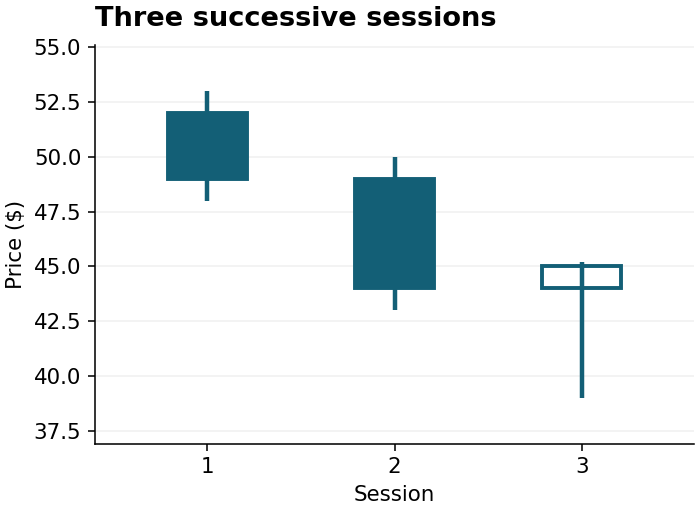

# Chartered Market Technician

In Anki Desktop, choose **File → Import** and select `release/CMT.apkg`. The current package contains 1,572 short-answer cards. Importing an update preserves existing card identities. Each prompt asks for one term, calculation, judgment, or chart reading. Sources and optional reasoning appear on the back.

## Practice reading charts

**320 cards use 193 distinct figures.** The 97 visual questions ask you to read evidence on the front. The other 223 place a worked diagram on the back after you have answered. In the Anki Browser, select the CMT deck and search `tag:visual::question`, `tag:visual::worked`, or `tag:medium::figure` for both. Combine with `tag:level::III` to focus on applied cases. By level, 165 illustrated cards appear in I, 157 in II and 104 in III. Shared cards count in each applicable level.

For a chart-only session, enter `deck:"Chartered Market Technician" tag:visual::question` in Browse. Add `tag:level::I` for 41 questions, `tag:level::II` for 60 or `tag:level::III` for 28. Examples include a breakout retest in I, a MACD crossover in II and a sector portfolio rebalance in III.

**Try one.** What single-candle pattern appears at the end of this decline?

Show the answer

A hammer. Read the preceding decline first, then look for the small real body near the high and the long lower shadow. The shape after an advance has a different name.

The [visual map](figures.tsv) connects the added illustrations and worked readings to specific card IDs. Alongside candle and point-and-figure practice, it includes volume confirmation, relative rotation, wave counts, expected shortfall, drawdowns and trade sizing. The examples use illustrative data.

## Coverage of the 2026 guide

The rows below count printed learning objectives, including repetitions. Ethics is assessed at every level and is tracked separately. The [objective audit](objective-audit.csv) lists each statement by guide page and position and links it to specific card IDs. The published [coverage map](release/coverage.csv) also records chapter mappings and the five application skills shared by the Level II and III exam overviews. [Official program guide](https://cmtassociation.org/wp-content/uploads/2025/12/CMT-PROGRAM-GUIDE-2026-1.pdf)

| Level | Objectives | Direct practice | Partial practice | No matched exercise | Direct with ≥3 exercises in ≥2 formats |
| --- | ---: | ---: | ---: | ---: | ---: |
| I | 244 | 244 | 0 | 0 | 244 |
| II | 125 | 125 | 0 | 0 | 125 |
| III | 109 | 109 | 0 | 0 | 109 |
| Total | 478 | 478 | 0 | 0 | 478 |

Direct means one or more exercises elicit the objective. Partial means the matched cards elicit only some of its components or prerequisites. The last column counts linked exercises and their tagged formats, such as recall, chart reading, or calculation. It screens for shallow practice. Learner mastery requires independent assessment. The full assigned digital readings are not available in this workspace. Reading-specific claims require a source that establishes the particular method or result.

Every numbered objective has between 3 and 13 linked exercises. For Level II §9.2, the recall and case cards distinguish a setup, its trigger, and subsequent follow-through. A chapter-linked practice explanation identifies this sequence (item 97). The primary sources show how it works. [Practice explanation](https://www.scribd.com/document/969356319/CMT2-MOCK1) · [Jake Bernstein on momentum](https://trade-futures.com/concepts_in_divergence/concepts_in_divergence_2.html) · [CMT Association worked example](https://cmtassociation.org/technically_speaking/technically-speaking-august-2005/)

Counting each card once within a mapped domain gives 149 for theory and history, 631 for classical techniques, 425 for advanced techniques, 421 for application, and 90 for ethics. A card can practice more than one domain.

Some historical cases cite the named author’s 2025 reading and identify its sample period.

## Studying

Filter by `tag:level::I`, `tag:level::II`, or `tag:level::III`. The corresponding counts are 893, 610, 511. Shared evidence cards appear in each relevant level. To focus on one statement, use its level, unit and statement positions, e.g. `tag:los::II::06::02`. The deck includes 90 shared ethics cards. [CFA Institute Code and Standards](https://www.cfainstitute.org/standards/professionals/code-ethics-standards)

For example, search `tag:los::II::19::05` in Anki’s Browse window to see the seven prompts for the momentum-signal objective. One asks for the sequence from memory. Another describes a breakout that falls back below resistance and asks which stage failed. For an independent check after reviewing these cards, try an unfamiliar chart with the answer hidden and identify the trigger and the evidence of follow-through.

## Rebuilding

`cards.tsv`, `components.csv`, `objective-audit.csv`, and `media/` are the authoring sources. Run `just figures` to regenerate the new figures and visual map from `figures.py`. To regenerate the earlier chart PNGs from `chart-data.json`, run `python3 charts.py` with `rsvg-convert` installed. Run `just build release-next` from this directory and then `just test release-next`. The test imports the package and checks every card, chart, coverage row, and editable TSV update in a disposable Anki collection. Import the package before using `release/CMT.tsv` to install the model and media.
