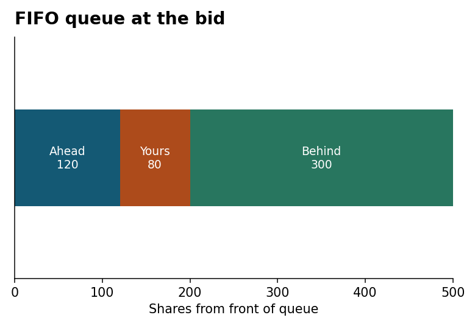

# Quantitative and Systematic Trading

Import **Quant-Systematic-Trading.apkg** into Anki. The course has 678 short-answer cards across 138 objectives. Thirty harder objectives have eight to ten independently scheduled questions each. The other 108 have four. All 253 code-generated figures work offline. [Anki package](release/Quant-Systematic-Trading.apkg) · [Editable Anki export](release/Quant-Systematic-Trading.tsv) · [Objective-by-objective coverage](release/coverage.csv)

**Try an execution question.** You have a bid resting in this FIFO queue. A market order sells 170 shares into the bid. With no cancellations or other changes, how many shares of your order remain?



<details><summary>Show the answer</summary>

**30 shares.** The seller trades with the 120 shares ahead of you first. That leaves 50 shares to trade with your 80. The orders behind yours receive no fill.

</details>

## Study the course

Start with domain 01 if returns and position accounting are new to you. Each objective progresses from a mechanism to a concrete application, a diagnostic question and a chart problem. Within a domain, the initial card order spaces those formats apart. Anki schedules each independently after review.

| In Anki Browse, combine the deck name with a tag | What it selects |
| --- | --- |
| `deck:"Quantitative and Systematic Trading" tag:visual::question` | 198 chart questions. Infer the answer before turning the card. |
| `deck:"Quantitative and Systematic Trading" tag:practice::example` | 138 independently scheduled chart cases corresponding to the core worked examples, one per objective. |
| `deck:"Quantitative and Systematic Trading" tag:visual::worked` | 193 text questions with an illustrated example on the back. |
| `deck:"Quantitative and Systematic Trading" tag:domain::09` | The 44 market, funding and tail-risk cards. |
| `deck:"Quantitative and Systematic Trading" tag:objective::optiontree` | Eight questions on one-period replication, from a single terminal payoff to a new two-state tree. |
| `deck:"Quantitative and Systematic Trading" tag:practice::step` | 96 short questions on individual operations and decisions within harder objectives. |
| `deck:"Quantitative and Systematic Trading" tag:practice::transfer` | 30 questions with a chart and dataset unique to that card. Use this search for mixed practice after a delay. |
| `deck:"Quantitative and Systematic Trading" tag:type::calculation` | Numerical exercises across the domains. |

### Working through a hard objective

For a scalar Kalman filter, one card asks for the signed difference between the observation and prediction. A chart card asks how much of that difference enters the update at a stated gain. Another gives the correction and asks for the new estimate. Finally, a fresh chart shows two filters responding to the same price and asks which one trusted the observation more. Search `tag:objective::kalman` within the deck to see all eight.

To check retention after a delay, try an example outside the review queue. Your predicted price is $90, the observation is $84 and the gain is one-third. Where does the updated estimate land?

<details><summary>Check your reasoning</summary>

**$88.** The observation is $6 below the prediction, so the innovation is −$6. The filter takes one-third of that change, a correction of −$2. An estimate of $92 points to a sign error. An estimate of $84 would use a gain of one.

</details>

The expanded practice covers covariance, beta, cointegration, GARCH, block bootstrap, rank IC, variance swaps, walk-forward validation, purging, shrinkage, risk contributions, Kelly sizing, expected shortfall, DV01, implementation shortfall, time-weighted return, attribution, duplicate fills, HAC errors, PCA, Kalman filters, Q-learning, Brownian scaling, FX forwards, put–call parity, binomial replication, gamma hedging, markouts, marginal capacity and ETF basket hedges.

Each objective still has a core chart shown on both a worked answer and an interpretation question. The 30 expanded objectives each have two further chart questions with fresh data. Another 55 diagrams appear only on worked answers. [Figure-to-card map](figures.tsv)

## Curriculum

| Domain | Skills | One decision you practice |
| --- | ---: | --- |
| 01 · Instruments and portfolio accounting | 9 | Compute a foreign position's return in the account currency. |
| 02 · Point-in-time data | 8 | Decide which release or quote was available at decision time. |
| 03 · Statistics and time series | 9 | Recover correlation from a covariance matrix. |
| 04 · Signal research and feature design | 8 | Determine when forecast decay erases a tradable edge. |
| 05 · Strategy families | 11 | Distinguish price mean reversion from bid–ask bounce. |
| 06 · Forecasting and machine learning | 8 | Find the probability bin in which a forecast is overconfident. |
| 07 · Backtesting and validity | 8 | Identify a training label that overlaps the test window. |
| 08 · Portfolio construction and sizing | 9 | Identify a dominated portfolio in risk–return space. |
| 09 · Tail, liquidity and funding risk | 9 | Calculate expected shortfall from equally weighted losses. |
| 10 · Microstructure and execution | 9 | Include unfilled shares in implementation shortfall. |
| 11 · Performance and attribution | 8 | Separate an external cash flow from investment return. |
| 12 · Production and controls | 8 | Reconcile a replayed fill without double-counting shares. |
| 13 · Advanced statistical and computational methods | 10 | Perform a Kalman update or a single Q-learning backup. |
| 14 · Cross-asset relative value | 10 | Determine the hedge for a binomial option payoff. |
| 15 · Integrated strategy reviews | 8 | Compare marginal net P&L when assigning capital. |
| 16 · Index, ETF and venue mechanics | 6 | Calculate whether an executable ETF spread pays the cost of creating shares. |

Coverage refers to the 138 objectives in this course. The curriculum draws on the seven lecture themes in NYU Tandon's introduction to quantitative equity trading and the three units in Georgia Tech's machine learning for trading course. It extends those foundations to cross-asset research and production controls. Programming projects and live trading competency require separate assessment. [Curriculum](curriculum.tsv) · [NYU Tandon syllabus](https://engineering.nyu.edu/sites/default/files/2020-07/Practical-Inroduction-to-Quantitative-Trading-baver.pdf) · [Georgia Tech CS 7646](https://omscs.gatech.edu/cs-7646-machine-learning-trading)

| Syllabus theme | Where to study it |
| --- | --- |
| NYU 1–2 · Markets, equity accounting, ETFs, indices and statistical arbitrage | 01, 04–05, 10, 16. Follow a position from quote and fill through P&L and benchmark exposure. |
| NYU 3–4 · Risk models, portfolios and historical simulations | 02–03, 07–09. Practice separating beta from residual returns and detecting research leakage. |
| NYU 5–6 · Signal families, combinations and multi-period decisions | 04–06, 08, 13. Compare signal horizons, transaction costs and continuation values. |
| NYU 7 · Real-world risks and constraints | 09–12, 15. Read stress losses, capacity curves and control failures. |
| Georgia Tech · Financial data, computational investing, and learning algorithms | 01–03 cover data and returns, 07–11 cover investment decisions and simulation, and 06 and 13 cover regression, trees, nearest neighbors and reinforcement learning. |

Each card includes its source. The coverage map links every objective to its card IDs and source. More detailed references include Palomar on portfolios, Boyd and coauthors on multi-period trading, and Hyndman and Athanasopoulos on forecasting. [Portfolio Optimization](https://portfoliooptimizationbook.com/book/) · [Multi-Period Trading via Convex Optimization](https://web.stanford.edu/~boyd/papers/cvx_portfolio.html) · [Forecasting: Principles and Practice](https://otexts.com/fpp3/)

## Rebuild and verify

Edit `cards.tsv` for prompts, answers and explanations. Edit `components.csv` and `curriculum.tsv` when the scope changes. Observations for chart questions are in `figure-data.json`; the supplemental diagrams are in `worked_examples.py`. Keep card IDs stable when revising a note. A worked answer should show how the result follows from the evidence. Give any follow-up decision its own front, checking for an existing card on that objective first.

From this directory run the following commands. The build expects a fresh output directory.

```sh
just figures
just build release-next
just test release-next
```

Verification imports the package in a temporary Anki collection, checks the card identities, figures and objective mappings, then edits and restores every note through a TSV re-import. For normal study, import the package to install its media and note type.
