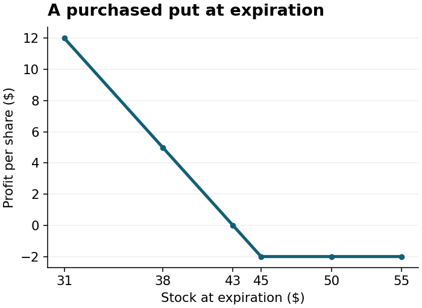

# Series 65

Import `Series-65.apkg` using **File → Import** in Anki. The early-2027 deck contains 1,200 cards. **159 cards use 86 original figures**, including yield curves, option profit diagrams, portfolio risk curves, cash-flow timelines and fee schedules.

**Try one.** At expiration a stock finishes at $38. Using the graph below, what net profit does one 100-share put contract earn?



<details><summary>Show the answer</summary>

$500. The graph shows profit per share after the premium. Multiply $5 by 100 shares.

</details>

## Find visual practice in Anki

| Search within this deck | Cards | What you see |
| --- | ---: | --- |
| `tag:visual::question` | 19 | The front supplies the chart. Read the payoff, calculate a spread or interpret the intercept before revealing the answer. |
| `tag:visual::worked` | 140 | Answer the original question first. The back shows a worked diagram with labeled units and a caption. |
| `tag:medium::figure` | 159 | All illustrated cards. Domain I has 50, II has 59, III has 46 and IV has 4. |

The figures use illustrative data and the assumptions stated on each card. Sources and scope appear on the answer side. The [outline map](coverage.csv) links the full deck to the exam topics; the [visual map](figures.tsv) identifies the figure and side of each illustrated card.

## Rebuild and verify

Edit `cards.tsv` for the underlying notes and `figures.py` for data, cues and descriptions. Preserve existing GUIDs and card IDs. The note type and deck configuration are in `model.json`. From this directory run:

```sh
just figures
just build release-next
just test release-next
```

The test imports the new package, verifies media and rendered fields, and checks that a TSV re-import updates each original note in place. The [editable Anki export](Series-65.tsv) uses HTML for local media. Import the package first to install the images and note type. [Original exam brief](goal.md)
